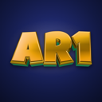
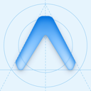
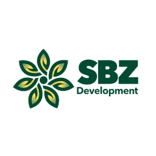

# Hi, I'm Francis 👋

**Software Engineer** · Lagos, Nigeria

I build products for real life, from the API underneath to the app in your pocket.

---

### About me

- 🛠️ I take products from idea to production: architecture, backend, web and mobile apps, and the operations that keep them running.
- ⚙️ My core is **C# / .NET**, with **TypeScript** and **Python** wherever the product needs them.
- 🎵 Right now I'm building [NoteFusion](https://notefusion.studio), which turns humming and singing into Tonic Solfa and sheet music.
- 📫 Open to new projects and roles. The quickest way to reach me is [email](mailto:francisgbohunmi@gmail.com).

### Tech stack

### Recent projects

| Project | What it does | Built with |
| :--- | :--- | :--- |
|  **[NoteFusion](https://notefusion.studio)** [Website](https://notefusion.studio) · [Google Play](https://play.google.com/store/apps/details?id=com.notefusion.com) | Hum, sing or paste a song link and get Tonic Solfa and staff notation, with SATB parts, practice and an offline hymn library. | .NET 10 · Python ML · React Native · PostgreSQL |
|  **[After Round 1](https://afterround1.tech)** [Play online](https://afterround1.tech) · [Google Play](https://play.google.com/store/apps/details?id=com.afterround1.com) | A Nigerian-inspired, real-time finger-count game played with friends, bots or a 16-level story mode. | .NET 10 · SignalR · Next.js · three.js · Redis |
|  **Heartpact** formerly 2gether | Dares, hearts and a daily ritual for couples. The phone's camera counts every rep. | Kotlin · MediaPipe · .NET 10 · SignalR |
|  **Glazion v2** private beta | The API behind a ceramic glaze research platform: recipes, UMF chemistry, photo capture and recipe-to-image search. | .NET 10 · PostgreSQL · Cloudflare R2 |
|  **Recchx** | A safety network for the people you love: live location, safe-arrival timers and covert SOS that works offline. | .NET 8 · React Native · SignalR |
|  **[SBZ Farms](https://sbz-fms-web.vercel.app)** | Farm operations in one place: birds, eggs, feed, sales, payroll and audit trails. | .NET 10 · CQRS · PostgreSQL |

Most of these repositories are private. Access for review is available on request.

### Experience

| Role | Company | When |
| :--- | :--- | :--- |
| Backend Developer / QA Tester | **Model Carbon Ltd**: Converge ERP for Heirs Technologies (UBA Group) | 2025 – 2026 |
| Backend Developer | **Kuda MFB**: subscriptions, referral rewards and loyalty | 2025 |
| .NET Developer | **X3 Lab**: APIs for a university edtech platform | 2025 |

🎓 **B.Tech, Statistics**, Federal University of Technology, Akure

---

Building products for real life, one release at a time.

